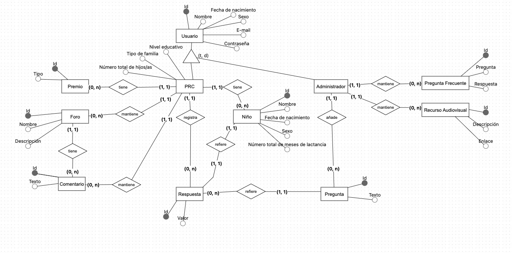
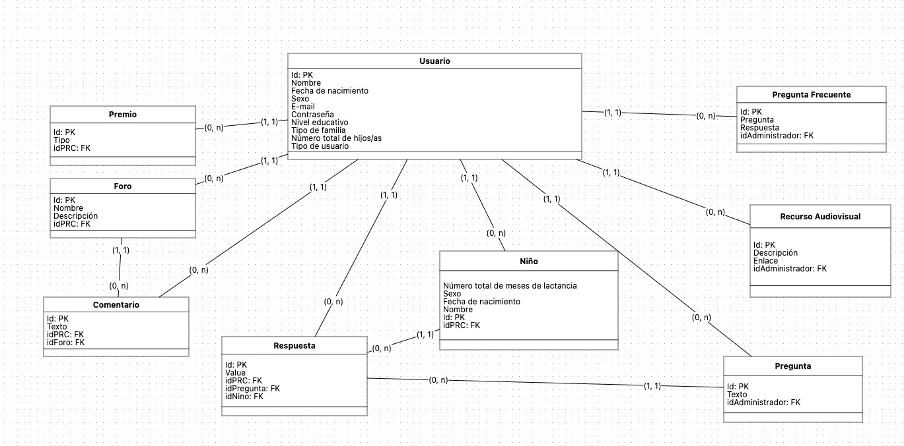

# CRIApp — Resumen del proyecto para el tutor

Hola Profesor Javier,

Te escribo para ponerte al día del estado del proyecto CRIApp y darte acceso a todo el material técnico antes de la entrega del anteproyecto.

---

## 1. ¿Qué es CRIApp?

**CRIApp** es una plataforma digital de apoyo a la crianza que combina una **API REST** (backend en .NET 8 + PostgreSQL) con una **aplicación Android** (Kotlin) como interfaz para las familias.

El sistema permite:

- **Autenticación completa** — registro, login, recuperación y restablecimiento de contraseña.
- **Gestión de perfil** — datos del usuario y actualización de información personal.
- **Gestión de hijos/as** — registro, listado y edición de los menores vinculados a la cuenta.
- **Cuestionarios diarios** — cada hijo recibe 10 preguntas diarias en escala Likert. El sistema guarda las respuestas con fecha, usuario e hijo asociados.
- **Sistema de premios** — puntuación acumulada por respuestas.
- **Foros comunitarios** — creación, edición, consulta y comentarios entre usuarios.
- **Preguntas frecuentes (FAQ)** — catálogo precargado consultable desde la app.
- **Recursos audiovisuales** — contenido educativo precargado accesible desde la interfaz móvil.
- **Notificaciones** — recordatorios automáticos para usuarios con preguntas pendientes.

---

## 2. Modelos de datos

A continuación los diagramas que describen la estructura de datos del sistema:

### Diagrama entidad-relación

*PRC - Persona Responsable de la Crianza 

**Con respecto a las features que involucran los administrados (mantener FAQ, preguntas y recursos audivisuales), no pienso incluirlas en el escopo del TFM. Mi idea al principio seria tener una web app para las gestiones de los administradores.

### Diagrama lógico del sistema

---

## 3. Requisitos técnicos detallados

El documento de requisitos técnicos (v1.4) recoge todos los requisitos funcionales (RF), no funcionales (RNF), de refactor Android (RFA) y de despliegue (RDEP), junto con su estado actual de implementación (**Implementado / Parcial / Pendiente**):

👉 [REQUISITOS_TECNICOS_CRIAPP.md](REQUISITOS_TECNICOS_CRIAPP.md)

---

## 4. Historias de usuario del ciclo final (backlog TFM)

Para el cierre del TFM hemos definido **15 historias de usuario** organizadas en 6 grupos, con criterios de aceptación en estilo BDD (Dado/Cuando/Entonces) y Definición de Hecho (DoD) clara:

| Grupo | Historia | Prioridad |
|---|---|---|
| A — Compromiso académico | [HU-001 Anteproyecto TFM](https://github.com/vieir4ndo/CRIApp/issues/28) | Alta |
| B — Fundamentos Android | [HU-002 Refactor MVVM por capas](https://github.com/vieir4ndo/CRIApp/issues/29) | Alta |
| B — Fundamentos Android | [HU-003 Cliente API robusto](https://github.com/vieir4ndo/CRIApp/issues/30) | Alta |
| B — Fundamentos Android | [HU-004 Cierre de primer login y onboarding](https://github.com/vieir4ndo/CRIApp/issues/31) | Alta |
| C — Calidad y seguridad | [HU-005 Hardening de API](https://github.com/vieir4ndo/CRIApp/issues/32) | Alta |
| C — Calidad y seguridad | [HU-006 Pruebas backend críticos](https://github.com/vieir4ndo/CRIApp/issues/33) | Alta |
| C — Calidad y seguridad | [HU-007 Observabilidad y logging](https://github.com/vieir4ndo/CRIApp/issues/34) | Media |
| D — Funcionalidades | [HU-008 Sistema de premios](https://github.com/vieir4ndo/CRIApp/issues/35) | Alta |
| D — Funcionalidades | [HU-009 Notificaciones útiles](https://github.com/vieir4ndo/CRIApp/issues/36) | Alta |
| D — Funcionalidades | [HU-010 Desactivación de cuenta end-to-end](https://github.com/vieir4ndo/CRIApp/issues/37) | Media |
| D — Funcionalidades | [HU-011 Recursos audiovisuales robustos](https://github.com/vieir4ndo/CRIApp/issues/38) | Media |
| D — Funcionalidades | [HU-012 Historial de notificaciones](https://github.com/vieir4ndo/CRIApp/issues/39) | Media |
| E — DevOps | [HU-013 Despliegue cloud gratuito](https://github.com/vieir4ndo/CRIApp/issues/40) | Alta |
| F — Cierre académico | [HU-014 Memoria final del TFM](https://github.com/vieir4ndo/CRIApp/issues/41) | Alta |
| F — Cierre académico | [HU-015 Preparación de defensa](https://github.com/vieir4ndo/CRIApp/issues/42) | Alta |

👉 [HISTORIAS_USUARIO_NUEVO_CICLO.md](HISTORIAS_USUARIO_NUEVO_CICLO.md)

Las historias también están creadas como **Issues en el repositorio de GitHub**, gestionadas mediante un **GitHub Project** (tablero Kanban) para seguimiento iterativo del backlog:

👉 [github.com/vieir4ndo/CRIApp/issues](https://github.com/vieir4ndo/CRIApp/issues)  
👉 [github.com/vieir4ndo/CRIApp/projects](https://github.com/vieir4ndo/CRIApp/projects)

---

## 5. Metodología de trabajo

El proyecto sigue un **enfoque ágil híbrido** que combina:

- **Scrum semanal** — cadencia de sprint con revisión y planificación cada semana.
- **Flujo Kanban** — gestión visual del tablero (Backlog → En progreso → Revisión → Hecho).
- **BDD/TDD como guía de criterios** — las historias de usuario incorporan criterios de aceptación en formato Dado/Cuando/Entonces y DoD verificable.

Este enfoque permite equilibrar el desarrollo técnico con los entregables académicos, manteniendo trazabilidad entre requisitos, implementación y evidencias para la memoria.

---

## 6. Decisión sobre autenticación externa

Evaluamos la posibilidad de migrar la autenticación actual a un proveedor externo de identidad (Auth0, Firebase Auth, Keycloak, etc.).

**Decisión:** no se migrará en esta fase del TFM.

**Razones principales:**

- La autenticación interna ya está completamente implementada y operativa: registro, login, recuperación y restablecimiento de contraseña, JWT propio, integración con mensajería (correo/SMS).
- La migración implicaría un coste estimado de **2 a 4 semanas** de trabajo real (integración de proveedor, cambio de contratos de token, refactor del cliente Android y reprueba end-to-end).
- Ese esfuerzo compromete los hitos académicos más críticos: refactor Android, pruebas, despliegue y memoria.
- La alternativa elegida es **mantener el auth interno y aplicar hardening** (secretos por variables de entorno, HTTPS, mejora de expiración/renovación de token, logging de eventos de seguridad) — impacto estimado de 4 a 8 días efectivos con mejor relación esfuerzo/resultado.
- La migración a auth externo queda documentada como **línea de trabajo futuro** en la memoria, con opción de PoC acotada si queda margen de tiempo.

---

## 7. Repositorios

Ya has sido añadido como colaborador en los siguientes repositorios:

| Repositorio | Descripción |
|---|---|
| [github.com/vieir4ndo/CRIApp](https://github.com/vieir4ndo/CRIApp) | Repositorio principal |
| [github.com/vieir4ndo/criapp-api](https://github.com/vieir4ndo/criapp-api) | Repositorio de la API REST (.NET 8 + PostgreSQL) |
| [github.com/vieir4ndo/criapp-android](https://github.com/vieir4ndo/criapp-android) | Repositorio de la aplicación Android (Kotlin) |

---

## 8. Anteproyecto

Adjunto el anteproyecto (Anexo I) para tu revisión. ¿Crees que está listo para subir a Moodle tal como está, o hay algún cambio que deba hacer antes de enviarlo?

📎 [`MiW.TFM.Anteproyecto.AnexoI.docx`](MiW.TFM.Anteproyecto.AnexoI.docx)

Muchas gracias por tu tiempo.

Un saludo,  
Matheus
