# CRIApp - Documento Tecnico de Requisitos

Fecha: 30 de marzo de 2026  
Version: 1.4 (revision de calidad para memoria final)

## 1. Proposito

Este documento define los requisitos tecnicos de CRIApp para:

- Registrar formalmente el alcance funcional y no funcional del sistema.
- Evaluar el estado actual de implementacion (Implementado, Parcial o Pendiente).
- Establecer criterios objetivos de cierre para el TFM.
- Reutilizar el contenido como base de trazabilidad en la memoria final.

## 2. Alcance del sistema

CRIApp es una solucion cliente-servidor de apoyo a la crianza con los siguientes componentes:

- Backend: API REST en .NET 8.
- Frontend: aplicacion Android en Kotlin.
- Persistencia: PostgreSQL.

El alcance incluye autenticacion, gestion de perfil y de hijos, flujo diario de preguntas/respuestas, foros, FAQ, recursos audiovisuales, notificaciones y sistema de premios.

## 3. Escalas de prioridad y estado

Prioridad:

- Alta: imprescindible para demo, defensa y cierre del TFM.
- Media: aporta valor directo al producto y debe abordarse en el ciclo final.
- Baja: mejora evolutiva no bloqueante.

Estado:

- Implementado: funcionalidad operativa y validada en flujo principal.
- Parcial: existe implementacion, pero con brechas tecnicas o funcionales.
- Pendiente: no existe implementacion suficiente para validacion.

## 4. Requisitos funcionales (RF)

| ID | Requisito funcional | Prioridad | Estado | Descripcion y criterio verificable | Vistas implementadas |
|---|---|---|---|---|--|
| RF-001 | El sistema debe permitir el registro de nuevos usuarios mediante el ingreso de datos personales | Alta | Implementado | El sistema debe permitir registrar usuarios con: nombre (obligatorio), nombre de usuario (obligatorio, correo o movil), fecha de nacimiento (obligatoria), sexo (obligatorio), nivel educativo (opcional), tipo de familia (opcional) y numero de hijos (opcional, >= 0). Criterio: no se crea la cuenta si faltan obligatorios o si el nombre de usuario ya existe; tras el alta, el usuario recibe mensaje de bienvenida (correo/SMS) y puede iniciar sesion. | 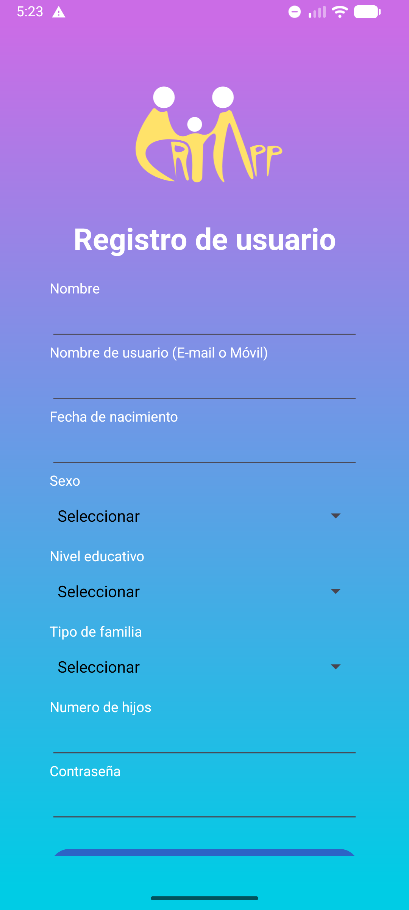 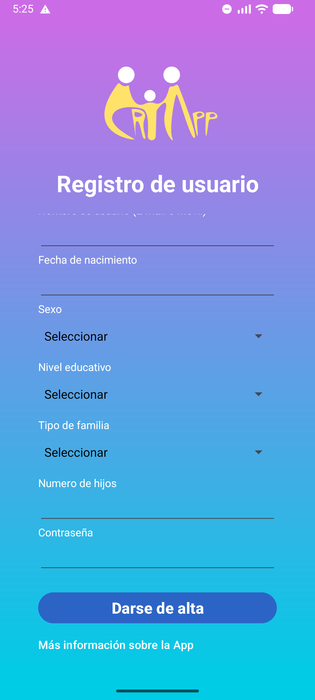 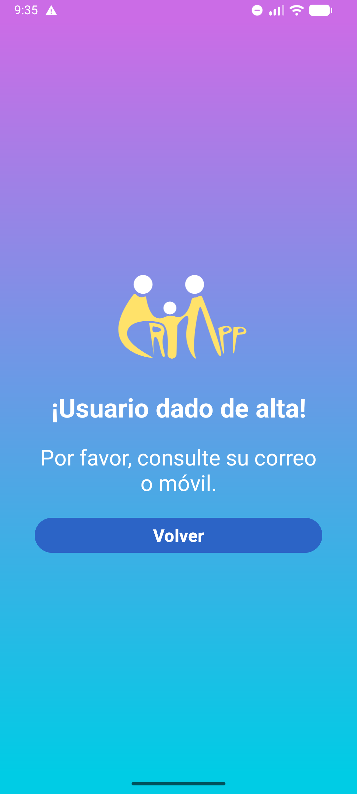 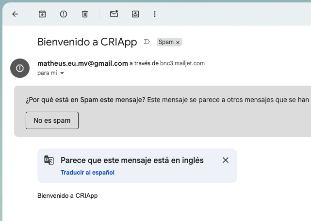 |
| RF-002 | El sistema debe permitir a los usuarios iniciar sesión con sus credenciales | Alta | Parcial | El sistema debe autenticar con nombre de usuario y contrasena validos. Criterio: credenciales incorrectas devuelven error controlado; en primer acceso se muestran pantallas de bienvenida una unica vez. Pendiente: cerrar validacion de primer login en frontend. | 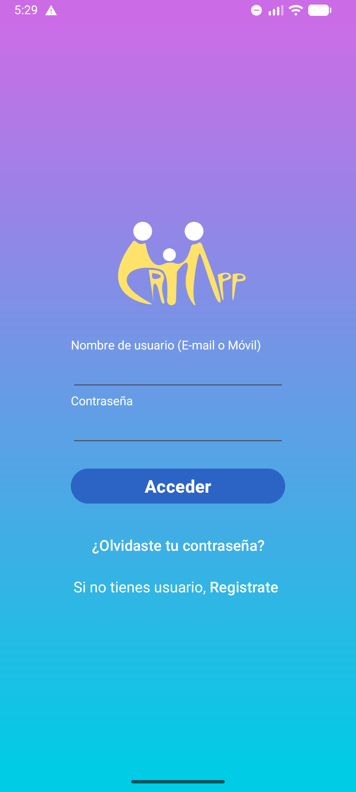 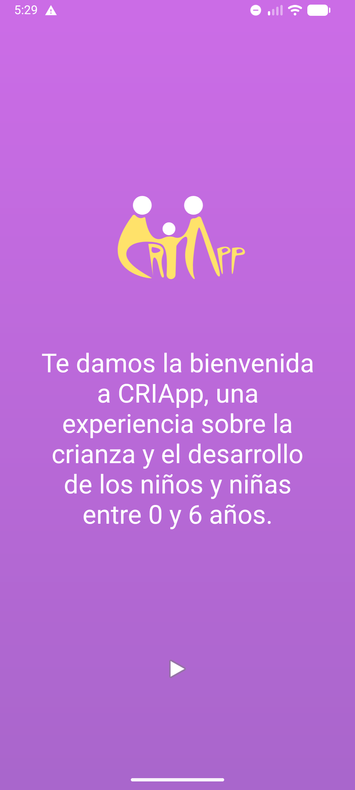 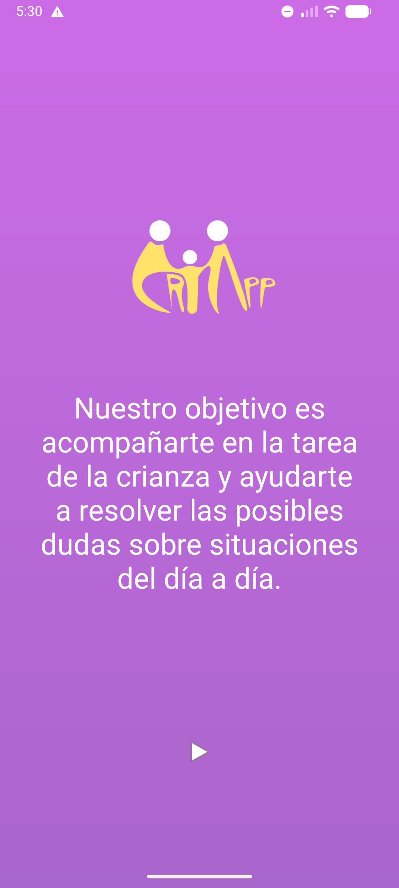 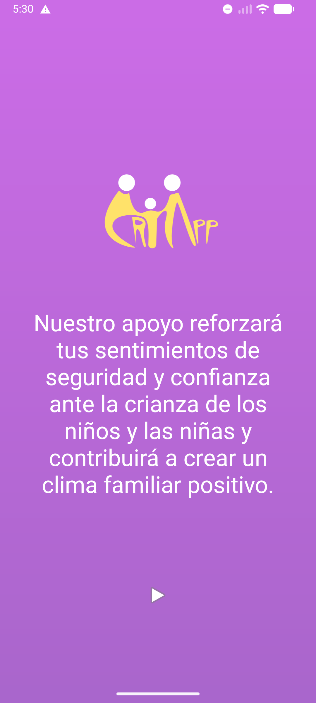   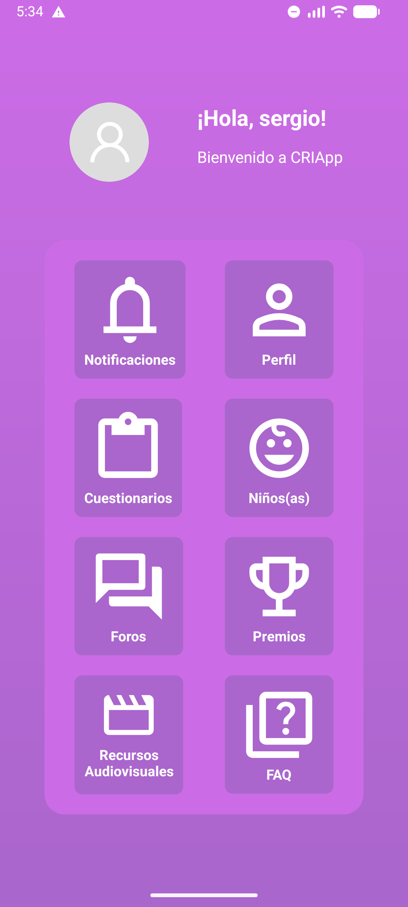 |
| RF-003 | El sistema debe permitir la recuperación de contraseña mediante el envío de un código | Alta | Implementado | El usuario debe poder solicitar recuperacion informando correo o movil. Criterio: el sistema genera y envia un codigo temporal por el canal disponible y registra el intento. |  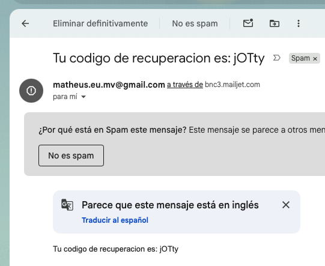|
| RF-004 | El sistema debe permitir restablecer la contraseña mediante validación de código | Alta | Implementado | El usuario debe poder actualizar su contrasena tras validar codigo vigente. Criterio: solo se acepta codigo valido/no expirado; al confirmar, la contrasena anterior deja de ser valida. | 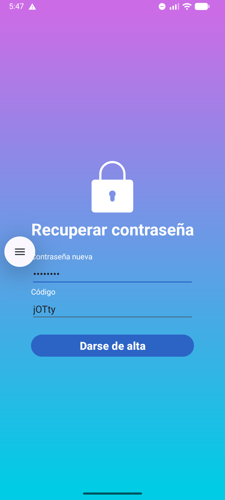 |
| RF-005 | El sistema debe permitir a los usuarios autenticados consultar su perfil | Alta | Implementado | El sistema debe mostrar los datos de perfil registrados del usuario autenticado. Criterio: se devuelve informacion de perfil sin exponer credenciales ni datos sensibles innecesarios. | 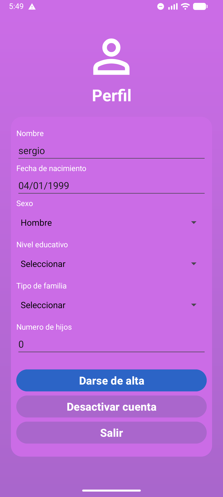 |
| RF-006 | El sistema debe permitir a los usuarios autenticados actualizar su perfil | Alta | Implementado | El usuario debe editar sus datos de perfil bajo las mismas reglas de validacion del registro. Criterio: los cambios persisten correctamente y se bloquean actualizaciones invalidas. | |
| RF-007 | El sistema debe permitir la desactivación de cuentas de usuario | Media | Parcial | El usuario debe poder desactivar su cuenta. Criterio: la cuenta desactivada no puede iniciar sesion y el frontend debe reflejar el estado. Pendiente: completar flujo en app Android y validar comportamiento integral. |  |
| RF-008 | El sistema debe permitir registrar hijos/as asociados a una cuenta de usuario | Alta | Implementado | El sistema debe registrar hijos con: nombre (obligatorio), fecha de nacimiento (obligatoria), sexo (obligatorio), prematuridad (obligatoria) y meses de lactancia (obligatorio, >= 0). Criterio: no se guardan registros con datos invalidos. | 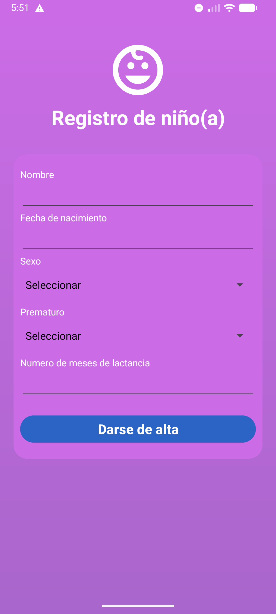 |
| RF-009 | El sistema debe permitir listar los hijos/as asociados a un usuario | Alta | Implementado | El usuario debe consultar todos sus hijos y su informacion asociada. Criterio: el listado solo incluye hijos vinculados a la cuenta autenticada. | 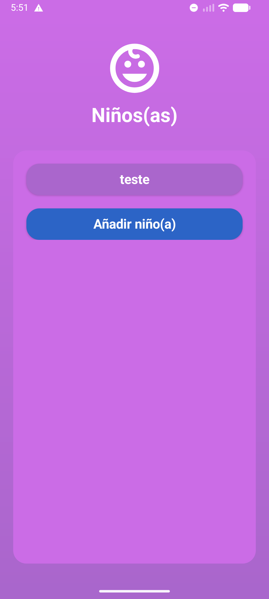 |
| RF-010 | El sistema debe permitir editar la información de los hijos/as | Alta | Implementado | El usuario debe actualizar datos de cada hijo aplicando reglas de validacion de creacion. Criterio: la edicion persiste y no permite valores fuera de regla. | 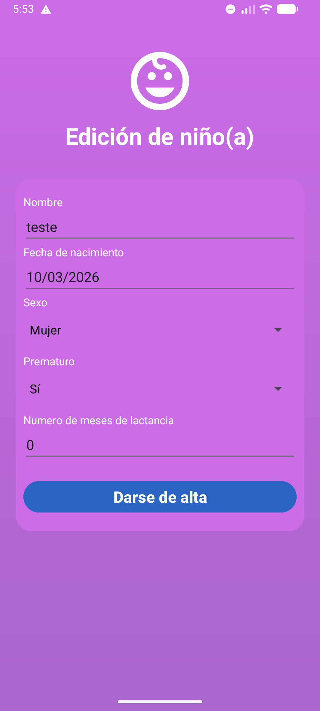 |
| RF-011 | El sistema debe guardar automaticamente las preguntas en la base de datos | Alta | Implementado | El sistema debe inicializar automaticamente el catalogo de preguntas predefinidas en base de datos. Criterio: al arrancar en entorno limpio, las preguntas base quedan disponibles sin carga manual. |
| RF-012 | El sistema debe listar preguntas disponibles para ser respondidas por cada hijo/a | Alta | Implementado | El sistema debe entregar 10 preguntas diarias por cada hijo, segun reglas predefinidas. Criterio: cada hijo recibe su conjunto diario y no se repiten preguntas fuera de la logica definida. |   |
| RF-013 | El sistema debe permitir registrar las respuestas proporcionadas por los usuario | Alta | Implementado | El sistema debe guardar respuestas en escala Likert asociadas a usuario, hijo, pregunta y fecha. Criterio: al confirmar avance del flujo, la respuesta queda persistida con valor numerico valido. | 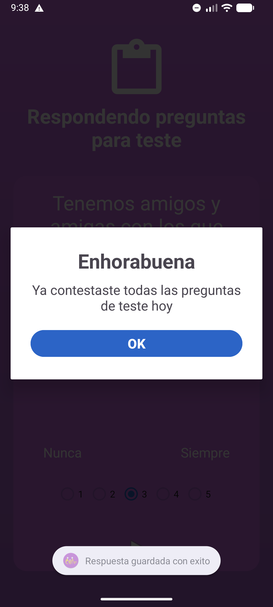 |
| RF-014 | El sistema debe permitir la creación de foros por parte de los usuarios | Media | Implementado | El usuario autenticado debe poder crear foros indicando nombre y descripcion. Criterio: no se crean foros con campos obligatorios vacios. | 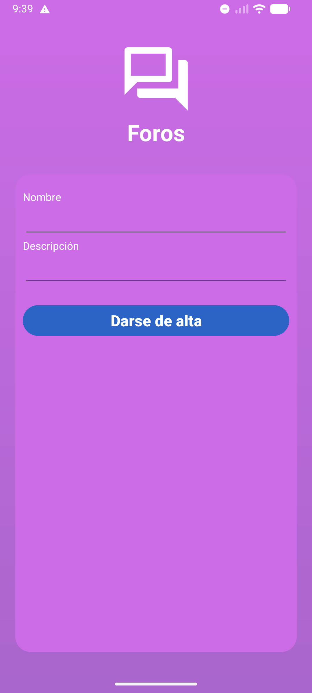 |
| RF-015 | El sistema debe permitir consultar foros y su detalle | Media | Implementado | El sistema debe listar foros y mostrar detalle (nombre, descripcion, comentarios y autores). Criterio: el detalle recupera contenido completo y consistente del foro seleccionado. |  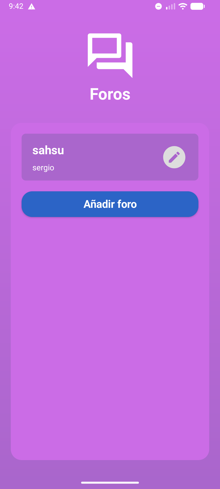 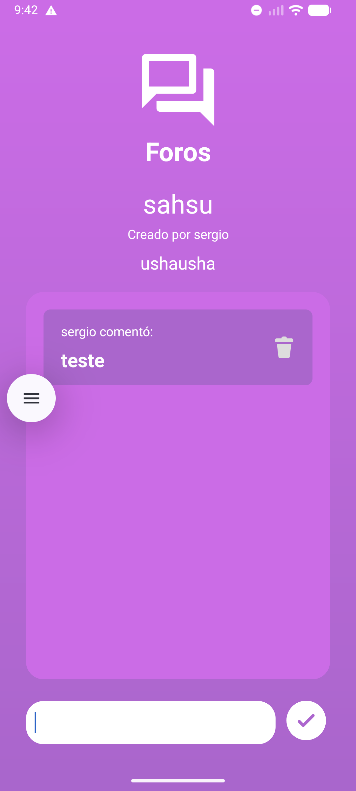 |
| RF-016 | El sistema debe permitir editar foros por usuarios autorizados | Media | Implementado | Solo el propietario del foro puede editar nombre y descripcion. Criterio: peticiones de terceros no autorizados deben devolver rechazo de autorizacion. | 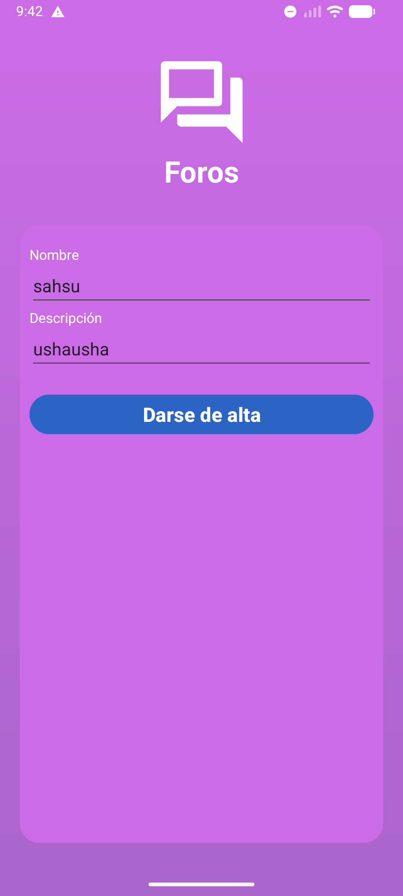 |
| RF-017 | El sistema debe permitir comentar en los foros | Media | Implementado | Cualquier usuario autenticado debe poder comentar en foros propios o ajenos. Criterio: el comentario queda asociado a autor, foro y fecha. | 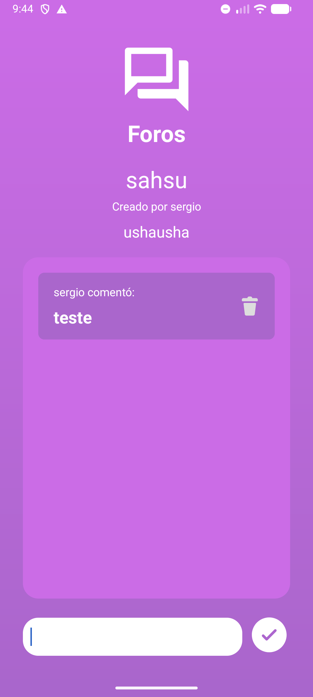 |
| RF-018 | El sistema debe guardar automaticamente las preguntas frecuentes (FAQ) en la base de datos | Alta | Implementado | El sistema debe inicializar automaticamente preguntas frecuentes predefinidas. Criterio: las FAQ base aparecen disponibles sin operacion manual posterior al despliegue. |
| RF-019 | El sistema debe permitir consultar preguntas frecuentes (FAQ) | Media | Implementado | El usuario debe consultar FAQ en formato de lista desplegable o equivalente. Criterio: se muestran pregunta y respuesta de forma clara y accesible. |  |
| RF-020 | El sistema debe guardar automaticamente los recursos audivisuales en la base de datos | Alta | Implementado | El sistema debe inicializar recursos audiovisuales predefinidos para consulta. Criterio: en entorno limpio, los recursos quedan disponibles tras inicializacion. |
| RF-021 | El sistema debe permitir consultar recursos audiovisuales | Media | Parcial, necesita revisar implementación de visualización de contenido en video | El usuario debe visualizar recursos desde la app sin abandonar el flujo principal. Criterio: los enlaces/embebidos cargan correctamente desde la interfaz movil. |  |
| RF-022 | El sistema debe generar y asignar premios en función de la puntuación de los usuarios | Media | Pendiente | El sistema debe calcular puntuacion diaria y asignar premios por umbrales. Regla propuesta: Bronce (100), Plata (500), Oro (1000), Diamante (>= 10000). Criterio: el calculo se ejecuta de forma programada y registra historico de cambios. |
| RF-023 | El sistema debe permitir consultar los premios de un usuario | Alta | Pendiente | El usuario debe consultar su puntuacion total y el estado de cada premio. Criterio: premios alcanzados se distinguen visualmente de los no alcanzados (por ejemplo, color vs escala de grises). |
| RF-024 | El sistema debe generar notificaciones diarias para avisar los usuários que deben responder las preguntas para sus hijos | Media | Pendiente | El sistema debe evaluar periodicamente usuarios con preguntas pendientes y enviar como maximo una notificacion diaria por usuario. Criterio: cada envio queda registrado; no se duplican notificaciones en el mismo dia natural. |
| RF-025 | El sistema debe permitir consultar las notificaciones enviadas al usuario | Media | Pendiente | El usuario debe consultar su historial de notificaciones. Criterio: el listado muestra al menos tipo, contenido, fecha y estado de lectura/entrega cuando aplique. |

## 5. Requisitos no funcionales (RNF)

| ID | Requisito no funcional | Prioridad | Estado | Criterio verificable |
|---|---|---|---|---|
| RNF-001 | Seguridad de secretos por variables de entorno | Alta | Pendiente | No exponer claves ni credenciales en repositorio, appsettings versionados o binarios del cliente. |
| RNF-002 | Cifrado de trafico (HTTPS) en despliegue | Alta | Parcial | API publica accesible por HTTPS con redireccion activa y certificado valido. |
| RNF-003 | Rendimiento en consultas listadas | Media | Parcial | Paginacion en colecciones principales (foros, preguntas, comentarios) y tiempos de respuesta estables. |
| RNF-004 | Observabilidad y logging estructurado | Media | Pendiente | Logs con contexto tecnico y de negocio para trazabilidad de errores y eventos clave. |
| RNF-005 | Pruebas automatizadas backend | Alta | Pendiente | Suite de pruebas unitarias/integracion para servicios y endpoints criticos con ejecucion en CI. |
| RNF-006 | Despliegue reproducible en nube | Alta | Pendiente | Pipeline definido y guia de despliegue validada en proveedor gratuito seleccionado. |

## 6. Requisitos tecnicos especificos del refactor Android (RFA)

Estos requisitos incorporan el objetivo academico de aplicar aprendizajes del master en arquitectura, mantenibilidad y calidad.

| ID | Requisito de refactor Android | Prioridad |
|---|---|---|
| RFA-001 | Introducir arquitectura MVVM por capas | Alta |
| RFA-002 | Refactorizar las interacciones con API mediante cliente HTTP centralizado y manejo unificado de errores | Alta | 
| RFA-003 | Mejorar el ciclo de vida y gestion de eventos en Activities/Fragments, evitando logica de negocio en UI | Alta | 

## 7. Requisitos tecnicos de despliegue API en nube gratuita (RDEP)

| ID | Requisito de despliegue | Prioridad |
|---|---|---|---|
| RDEP-001 | Seleccionar proveedor cloud con plan gratuito viable para demo del TFM | Alta | 
| RDEP-002 | Configurar secretos y parametros por variables de entorno | Alta | 
| RDEP-003 | Publicar API accesible por HTTPS con URL publica estable | Alta | 
| RDEP-004 | Configurar base de datos compatible, migraciones y politica minima de respaldo | Alta | 
| RDEP-005 | Definir proceso CI/CD basico (build, test y deploy) | Media |

Documento vivo: actualizar al cierre de cada sprint con cambios de estado, evidencias y decisiones tecnicas relevantes.